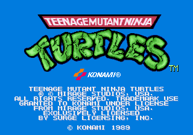
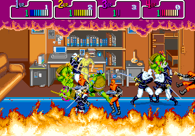
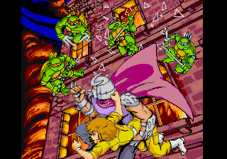
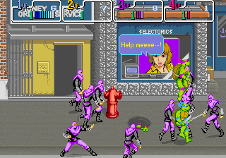
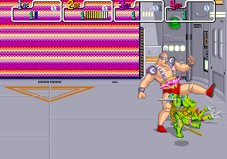
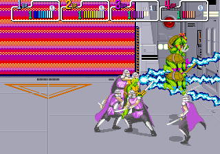

# Teenage Mutant Ninja Turtles — decompilation

A reconstruction of Konami's 1989 arcade game *Teenage Mutant Ninja Turtles* (a 68000 main board with a Z80
sound board) into platform-agnostic C, not an emulator, following the method of
[segasonic-decomp](https://github.com/cheviman/segasonic-decomp) and
[outrunners-decomp](https://github.com/cheviman/outrunners-decomp): both of the game's programs decompiled one
function at a time into readable C, and checked frame by frame against MAME in state, picture and sound.

**Apart from the screenshots on this page, this repository contains no game data.** The game's programs are here
as C, decompiled from the original machine code (`src/`); as with [n64decomp/sm64](https://github.com/n64decomp/sm64),
you bring your own ROM set (MAME's `tmnt`) for everything else: the tools verify it, extract the assets, and you
build your own executable, which runs from the assets and opens no ROM.

<p align="center">
  
  
  
  
  
  
</p>
<p align="center"><sub>Frames drawn by the game's own video library (<code>runtime/src/video.c</code>) while the
decompiled game plays the scenarios of <code>tests/controls/</code>.</sub></p>

## Status

As of 04-11-2026:

- [x] ROM set verification (MAME set `tmnt`, World 4 Players, version X), by CRC32 and SHA-1 of every file
- [x] A reference: the original programs on MAME's 68000 and Z80 cores, with MAME's K052109, K051960, K007232
      and uPD7759 and ymfm's YM2151, against a model of the board in C (`kref`, in the shared core)
- [x] 18 scenarios (`tests/controls/`): the attract mode, the test mode through every page and sound, games of
      one and four players, the continue and GAME OVER, the story before area 0 with no button pressed to its end,
      the DIP switches, and a game in each of the ten areas played until its boss falls, the last one through the
      ending and the staff roll: 513,383 frames, which run 25,526 addresses of the 68000 program and 4,486 of the
      Z80's
- [x] A 68000 disassembler identical to MAME's at every offset of the program and of an image of every opcode,
      and a static analysis that finds, without traces, every address the scenarios run: 28,515 instructions
      in the 68000 program, and the Z80's the same way
- [x] Every byte of both programs explained: the 68000's 32.5 % code, 65.9 % data described with its layout,
      types and a name, 1.6 % fill; the Z80's 35.6 % code, 64.3 % data, 0.1 % fill. Nothing unexplained
- [x] Both programs decompiled: 2,058 functions of the 68000 program and 381 of the sound program, no goto,
      every function, variable, field, parameter and local with a name and every function with a comment, the
      data read by name from the assets, never through an address of the ROM. 2,423 of the 2,439 functions
      (99.3 %, and 99.9 % of the lines) have nothing in them but the faithful leftovers "Reading the C" lists;
      each of the other 16 has its reason there too
- [x] The game matches the reference in state, picture and sound in all 18 scenarios, frame by frame, and its
      own sound board matches MAME's in every frame (samples and RAM); the structure of every function, the
      code no scenario runs too, checks against its jumps; no executable holds a stretch of the ROM set
- [x] The board in C (`runtime/`): the memory map, the inputs, the interrupts, the video chips drawing what MAME
      draws pixel for pixel, the YM2151, the K007232, the uPD7759 and the title music sample making the samples
      MAME makes
- [x] The assets (see "The assets"): tiles and sprites in sheets by subject with their own colours, the
      programs' data as text by subject with every piece named, the samples as WAV, the music as Standard MIDI
      Files; the game loads them, and they build back into the ROM set byte for byte
- [x] A window port (`ports/sdl2/`, SDL2): the game with its sound, the keyboard and four game controllers.
      Built and played on Windows; SDL2's packages should build it on Linux and macOS (not tried yet)
- [ ] Ports beyond the window one

## Getting started

Requirements: Python 3.10 or newer, CMake 3.20 or newer, a C11 and C++20 compiler (Visual Studio 2026 Build
Tools on Windows) and, for the game's window, the SDL2 development files: on Windows, unpack
`SDL2-devel-2.x.x-VC.zip` from [SDL's releases](https://github.com/libsdl-org/SDL/releases) into
`build/downloads/sdl2/`; elsewhere, the system's package (`libsdl2-dev`). Without SDL2 only the headless builds
are made.

1. Clone with the shared core, [arcade-decomp](https://github.com/cheviman/arcade-decomp), which this repository
   keeps in `tools/core` as a git submodule (a clone made without `--recursive` takes it with
   `git submodule update --init`):

   ```bash
   git clone --recursive https://github.com/cheviman/tmntarcade-decomp
   ```

2. Put your own copy of MAME's `tmnt` set in `rom/` (the .zip as is, or its files), and check it:

   ```bash
   python tools/verify_rom.py
   ```

   | File | Size | CRC32 | What it holds |
   |---|---|---|---|
   | `963-x23.j17`, `963-x24.k17` | 128 KB each | `a9549004`, `e5cc9067` | 68000 program, 0x00000-0x3FFFF (even, odd bytes) |
   | `963-x21.j15`, `963-x22.k15` | 64 KB each | `5789cf92`, `0a74e277` | 68000 program, 0x40000-0x5FFFF (even, odd bytes) |
   | `963e20.g13` | 32 KB | `1692a6d6` | Z80 sound program |
   | `963a28.h27`, `963a29.k27` | 512 KB each | `db4769a8`, `8069cd2e` | tile graphics (K052109) |
   | `963a17.h4`, `963a15.k4`, `963a18.h6`, `963a16.k6` | 512 KB each | `b5239a44`, `1f324eed`, `dd51adef`, `d4bd9984` | sprite graphics (K051960) |
   | `963a30.g7`, `963a31.g19` | 256 bytes each | `abd82680`, `f8004a1c` | sprite address decoder, priority PROMs |
   | `963a26.c13` | 128 KB | `e2ac3063` | K007232 samples |
   | `963a27.d18` | 128 KB | `2dfd674b` | uPD7759 speech |
   | `963a25.d5` | 512 KB | `fca078c7` | title music sample |

3. Extract the assets into `assets/`, and check that they build back into your ROM set byte for byte:

   ```bash
   python tools/extract_assets.py
   ```

   ```bash
   python tools/extract_assets.py --check
   ```

4. Build the game and the development tools into `build/bin/`:

   ```bash
   cmake -S . -B build/msvc
   ```

   ```bash
   cmake --build build/msvc --config Release --parallel 6
   ```

5. Play:

   ```bash
   build/bin/tmnt
   ```

   The game reads its assets from `--assets FOLDER`, or from an `assets` folder beside the executable or in the
   current folder; it opens no ROM. The executable can be copied anywhere with SDL2's library beside it
   (`SDL2.dll` on Windows, which the build puts next to it) and the assets: they come from your ROM set, so
   they are yours, not to share.

   Or run the game without a window, here with the controls of the attract mode, writing a hash of every
   frame:

   ```bash
   build/bin/tmnt_game_headless --script tests/controls/attract.txt --hashes build/attract.txt
   ```

## Playing

It is the arcade game for four: each player has a coin slot and no start button; a coin and the attack button
bring a turtle in (player 1 is Leonardo, 2 Michelangelo, 3 Donatello, 4 Raphael).

| Control | Keys |
|---|---|
| Move (player 1) | the arrow keys |
| Attack, jump | Z or left Ctrl; X or left Alt |
| Coins 1-4 | 5, 6, 7, 8 |
| Service | 9 |
| Full screen | F11 or Alt+Enter |
| Smooth or sharp pixels | F3 |
| Quit | Escape |

Game controllers are players 1 to 4 in the order they are plugged in: the pad or the left stick moves, A
attacks, B jumps, Back puts a coin in.

Options of `tmnt` and `tmnt_game_headless`: `--script FILE` plays a control script (format in
`runtime/include/tmnt/script.h`) instead of the controls (`tmnt --fast` runs it without waiting for each
frame's time); `--hashes`, `--video-hashes` and `--sound-hashes FILE` write a hash of every frame's state,
picture and sound, as the reference does; `--service` turns the test mode's DIP switch on; `--assets FOLDER`
says where the assets are. `tmnt_game_headless` also takes `--frames N`, `--dump FRAME --dump-dir DIR` (the
board's memories at the end of a frame) and `--video-dump FRAME ... --video-dir DIR` (those frames' pictures as BMP,
as the game's own video draws them: the screenshots above).

## Changing the decompilation

`src/` is written by the decompiler from your ROM set, `symbols.txt` and `tools/game_profile.py`; `src/sound/`
from the sound program and `sound_symbols.txt`. Change those (names, types, comments, what the analysis cannot
work out alone), not the C, and write it again:

```bash
python tools/decompile.py
```

```bash
python tools/decompile_sound.py --checks
```

`decompile_sound.py` also writes the Z80's timing table, `build/sound/timing.txt`, which the reference needs to
keep the sound program's time as the game's own sound board does: run it once in a new clone before the checks
below.

`build/bin/kref` runs the original programs on MAME's cores against the same board model. Both it and the game
take the control scripts of `tests/controls/` (written by `tools/make_scenarios.py`), and both write hashes of
every frame. This runs every script on both, compares them frame by frame in state, picture and sound, and
checks that the static analysis alone finds all the code the reference ran (`--native-only` reuses the
reference's results of an earlier run, in `build/scenarios_frames/`):

```bash
python tools/check_scenarios.py --video --sound --jobs 6 --out build/scenarios_frames
```

The game's own sound board against MAME's, sample for sample:

```bash
python tools/check_sound_board.py --jobs 6 --bin build/bin
```

Every function's ifs, loops and switches against the program's jumps, the code no scenario runs too:

```bash
python tools/check_structure.py build/structure
```

What the C still has of the CPU, of the decompiler and of the ROM's places, against `tools/noise_baseline.txt`
(`--save` makes the current numbers the baseline):

```bash
python tools/noise_report.py
```

No executable holds a stretch of the ROM set:

```bash
python tools/rom_in_executables.py
```

Other tools:

- `tools/disassemble.py` writes the listing, `build/listing/tmnt.s`, with a report beside it.
- `tools/coverage.py --reads build/scenarios` classifies every byte of the 68000 program (code, data the code or
  `symbols.txt` describes, fill) with the bytes the reference read as data (`kref --rom-reads FILE` for each
  script); `tools/sound_coverage.py` does the same for the sound program (`kref --sound-rom-reads`).
- `tools/data_walk.py` walks the data the engines read from where the code hands it over (animations, maps,
  palettes, texts, spawn lists...): `build/listing/data_walk.txt`.
- `tools/graphics_subjects.py --run` runs `kref --graphics-uses` on every script (the tiles and sprites each
  scene shows first, with their palettes) and writes `graphics_subjects.txt`, which the extractor reads.
- `tools/recompile.py` writes the translation scaffold the decompiler grew from (a C statement per
  instruction); CMake builds it with `-DTMNT_SCAFFOLD=ON`, and `check_scenarios.py --translated` checks it.
- `python tools/decompile.py --trace --out DIR` writes a copy of the C in which every function reports itself;
  `--variables FILE` lists every local with the instructions that write it, which `symbols.txt`'s `local` lines
  name them by.
- `kref --dump FRAME ... --dump-dir DIR` saves the board's memories at the end of frames, `--video-dump FRAME
  ... --video-dir DIR` the frames as BMP, `--sound-wav FILE` the sound mixed, `--text FRAME` the fixed layer as
  text, `--jumps FILE` where each jump through a register went, `--video-check FILE` and `--sound-check` the
  game's own video and sound chips against MAME's, `--assets-check assets` the assets against the ROM set.
- `tools/core/konami/reference/compare_m68k_with_mame.py` checks the 68000 disassembler against MAME's, and
  `compare_lift_with_mame.py --c` the lift of every opcode against MAME's 68000 core, from random states.

## Layout

```
rom/                      your ROM set (not in the repository)
assets/, build/           made on your machine (not in the repository)
src/                      the 68000 program's C, decompiled (tools/decompile.py writes it), in files by subject
src/sound/                the Z80 sound program's C (tools/decompile_sound.py writes it)
symbols.txt               the 68000 program's names, types, structures and fields, parameters and locals, what
                          pointers point at, the files, and the layout of the tables the analysis cannot measure
                          alone; its comments keep the evidence for each name, and its "comment" lines are what
                          the C says above each function
sound_symbols.txt         the same for the sound program
graphics_subjects.txt     the subject of each tile and sprite the scenarios show, and the palettes, for the sheets
runtime/                  the board in C: its memory map, inputs and interrupts (machine.c), the video
                          (video.c), the sound board and its chips (sound_board.c, sound_cpu.c, ym2151.c,
                          sound_chips.c), the assets into the board's memories and the programs' data by name
                          (assets.c, music.c), and the decompiled programs' runtime (game_program.c, the frame,
                          the interrupts, the tables); part of the game
runtime/replaced.txt      the functions the board puts its own in place of (the boot's ROM test)
ports/headless/           the game with no screen or sound, for the checks
ports/sdl2/               the game in a window, on SDL2: picture, sound, keyboard and game controllers
tests/controls/           the control scripts: coins, buttons, moves and pokes by frame
tools/core/               arcade-decomp, the shared core (git submodule): the decompiler, the 68000 and Z80
                          frontends, the analyses, the checks; its konami/reference/ holds kref and the copies
                          of MAME's and ymfm's code it builds from
tools/game_profile.py     what the core needs to know of this game
tools/tmnt_rom.py         the ROM set: its files by hash, and the regions as the board lays them out
tools/verify_rom.py       the ROM set's check
tools/extract_assets.py   the assets from the ROM set, and --check back (tmnt_graphics, sound_assets,
                          data_assets, sound_data_assets, sound_music)
tools/sound_music.py      the songs as Standard MIDI Files, and back to the driver's bytes
tools/data_walk.py        the data the engines read, walked from the code
tools/sound_data_walk.py  the music's tracks, walked from the song table
tools/graphics_subjects.py  what each scene of the scenarios shows: graphics_subjects.txt
tools/make_scenarios.py   writes the control scripts
tools/disassemble.py      the static analysis: build/listing/tmnt.s and report.txt (the core's)
tools/coverage.py, sound_coverage.py   every byte of each program as code, data or fill
tools/decompile.py, decompile_sound.py   the programs as C
tools/check_scenarios.py, check_sound_board.py, check_structure.py, rom_in_executables.py   the checks
tools/noise_report.py     what the C still has of the CPU, against tools/noise_baseline.txt
```

## The assets

`python tools/extract_assets.py` writes them from your ROM set into `assets/`, by subject, and `--check` builds
every byte of the ROM set but the code back from them:

```
tiles/     the K052109's tiles in 19 tilesets: one an area (its layers' maps, and what its play shows besides),
           the fixed layer's fonts, logos and HUD, the speech balloons, the opening, the story before area 0, the
           pictures of the areas' exits, the ending
sprites/   the K051960's sprites in 306 sheets, by the animations that show them (the function that starts the
           animation, or the table it is in: leonardo_animation_set, krang_animations, enemy_rodney...)
sounds/    title.wav (the title music's sample), pcm/ (the K007232's 12 samples), speech/ (the uPD7759's 36
           voices), WAV files
sound/music/  a Standard MIDI File a song (area_0.mid ... area_9.mid, boss, continue, staff_roll, ending...),
           and music.txt: the songs table's entries each plays
data/      the 68000 program's data as text, a file a subject (animations, sprite lists, layers, palettes,
           palette effects, texts, screens, enemies, scroll, demos, tables), a section a piece, every piece named
sound_data.txt   the sound program's data the same way: the driver's tables, voices, instruments, drums
```

- **Sheets.** 8-bit indexed PNGs, 16 tiles or sprites a row: a pixel is the pen plus 16 times the palette it
  shows with, so the pens come back as they are, and the sheet's colours are the palettes its tiles and
  sprites show with in the game. A tile or sprite goes to the first sheet that uses it: the areas' maps and the
  animations first, then what each scene of the scenarios shows (`graphics_subjects.txt`), and one nothing uses
  or shows goes with its neighbours in the ROM; `tilesets.txt` and `sprites.txt` list each sheet's codes, and
  those neighbours on a line of their own.
- **Data.** A piece is a section, `[name]`, of typed lines that give its bytes back in order: numbers (`u8`,
  `u16`, `s16`, `u32`), `ref NAME` for the address of a piece or a function, `frame`, `end` and `jump` for an
  animation, `sprite` for a sprite list's entry, `colours` for a palette, `text` for the game's texts. A piece is
  named by `symbols.txt`, by the routine that reads it, by the named piece that points at it, or by the routines
  a table of states holds; none by its address.
- **Music.** One tick of a file is one of the driver's (24 a quarter note) and its tempo events give the
  game's speed (within 1 %); a track is one of the song's channels (the YM2151's seven, the K007232's two) with
  its loops and parts played as the driver plays them; a note is a Note On and Off at its key (the drums on
  General MIDI's percussion), and what MIDI has no event for (the octave, the instrument, the gate, detune,
  portamento, LFO, loops, calls, jumps, held notes, rests) is in sequencer-specific events with the driver's
  bytes. `tools/sound_music.py`'s docstring has the format.

Edit them and run the game: it loads them. A piece keeps its size (the code reaches the data at fixed places),
and so does a song's channel; a note's pitch and length, a palette's colours, a sprite's pixels can change.

## Reading the C

The 68000 program's C lives in `src/`, in files by subject:

```
game.h  ram.h  table.c   the prototypes; the work RAM's variables and structures, the data's tables and records
system/   boot.c         the reset, the RAM and ROM tests, the main loop that runs the jobs the frames queue
          frame.c        the VBLANK interrupt: the inputs, the frame's work, the game's states, the job queue
          test_mode.c    the exceptions' handler and the test mode's pages
          sound_commands.c   the commands to the sound board, queued and sent one a frame
          palette_editor.c, animation_viewer.c   two tools of the developers' no code runs
scenes/   attract.c  opening.c  intro.c  game.c  demo.c  area_exits.c  continue.c  ending.c  ranking.c
stage/    layers.c  scroll.c  area_clear.c  floor_map.c  fire.c  drill_arrival.c
engine/   sprites.c      the sprite engine: animations, the sprites into the K051960, the boxes
          directions.c   the direction from one object to another
objects/  turtles.c      the turtles: joining, the area's entry, the controls, the moves and the scroll
          states.c       the objects' state dispatcher and the enemies' and their shots' states
          spawns.c  krang.c  stockman.c  rock_soldiers.c  air_attacks.c  scenery.c  explosions.c  helpers.c
video/    palettes.c  texts.c  tile_blocks.c  speech_balloons.c
sound/    sound.h  main.c  commands.c  music.c  fm_effects.c  pcm_effects.c  chips.c  tables.c   the Z80's
```

Each file's header says what it holds; `symbols.txt`'s `file` lines give each stretch of the program to its file,
and a file's functions are in the order of their addresses. What the C uses besides memory is in
`runtime/include/game/support.h`.

- **Memory.** The game's variables are lvalues over the work RAM by name (`area`, `frame_count`); the work RAM is
  kept the other way round in the host's memory, so that a value of any width at any address is a value of the
  host's. Its structures are reached with `OBJECT(address)` (the 50 objects from 062000, `OBJECT_ADDRESS(n)`),
  `PLAYER(address)`, the coin slots, the layers (`LAYER_A`), the palette effects and requests: the game keeps
  24-bit addresses in its variables, as the original does. What each kind of object keeps in its bytes is a view
  of the object for its family of functions (`OBJECT(object)->enemy.target_direction`), and a family whose name
  starts with another's reads that one's fields too. The program's data are read by name from the assets: tables
  (`krang_animations[3]`, `TABLE16(name, i)` where the code reads one at another width or past its start), records
  (`ANIMATION_FRAME(frame)->last_sprite`), the bytes a pointer walks (`TEXT(p)`, `MAP_ENTRY(p)`). The video chips'
  memories are reached through the board's bus (`io_write8(sprite_place, priority)`), as the board has them.
- **Links.** The game keeps the low word of an object's address in a field: `LINKED(base, link)` is the object it
  names, in the page of `base`.
- **Registers.** Everything a function keeps in registers is a parameter, a result or a local, named by
  `symbols.txt` or by what it holds (the object a handler runs on is `object`). What one routine leaves in a part
  of a register and another reads before setting it, all through the frame, is the game's state, and the C keeps
  it in eight global variables named for what their readers take them as (`game.h`: `offset_high_word`,
  `object_loop_slot`, `palette_place`...); the runtime puts them back when an interrupt's handler returns, as the
  VBLANK handler puts back the registers it saves.
- **Results.** A function hands back one value as its return value and more through pointers
  (`uint32_t *p_object`); a caller's variable goes in and comes out.
- **Comments.** Every function has a comment above it in the game's terms (the `comment` lines of `symbols.txt`
  and `sound_symbols.txt`); code nothing runs starts with "Unused:". The rest of `symbols.txt`'s comments keep the
  evidence: the instructions of the listing that show each name.
- **Control flow.** Loops, `if`, `switch` and `return` come from the original's branches; there is no `goto`. A
  jump through a table of handlers is a `switch` on the handler the table holds, its cases named after them
  (`case krang_appear_ADDRESS:`). Where the original's jumps cross in a way blocks cannot, a `bool` named after
  the place the jump goes to carries it: 8 functions (`draw_sprites`, `turtle_move`, `update_layers_street`,
  `enemy_think` and the three bosses', and the sound program's `read_track`). A function whose every path returns
  from a switch ends with `unreachable()`.
- **Interrupts and the frame.** `frame_wait()` is where the main loop finds no job and the board moves on to the
  next frame, `take_interrupts()` where the interrupts raised are handled; the interrupt handlers are ordinary
  functions. The boot's ROM test is the board's own (`BOARD_ORIGINAL`, `runtime/replaced.txt`): the game has no
  ROM to sum.
- **The sound program.** `src/sound/` is the Z80 program the same way: its channels' records by what plays on
  each (`CHANNEL(SPEECH)->sound`, `CHANNEL(MUSIC_FM_6)`), their fields as the music and the effects use them,
  the chips through the board; `z80_block(cycles)` opens each stretch of code with the time it takes, so the
  chips' timers, the interrupt and the samples happen when they did on the board.

What the C keeps of the original's machine code, and why (`python tools/noise_report.py`):

- 8 global variables for what the frame carries in registers (above).
- 301 places that read or write several fields at once or a table at another width (`AS16`, `AT8`, `TABLE16`):
  the original does.
- 140 partial writes of a variable, `x = (x & ~0xFFu) | y`: a byte written into a value whose other bytes are
  read afterwards; 3 of them put a part of one value into another.
- 474 places that reach memory through an address the code works out (`mem_read8`, `mem_write32`): the memory
  routines that clear, copy or test memory wherever they are told (`tools/game_profile.py` lists each with its
  reason) and the functions below; and 813 reads and writes of the board's devices through the bus.
- 878 values the decompiler works out once, named by a number (`t1`), 357 locals that keep a flag of the CPU
  for a later branch, and 2,820 casts.
- 3 results written back before an early return, and one routine nothing runs that keeps a stack frame the C has
  not (`lost_stack`).

16 functions have more than that, each for a reason: the 8 with a control flag; the enemies' retargeting
(`enemy_think` and the three bosses') reads a second slot that may be none through the bus, as the original
does; the demo's input channels read past a player's record (`update_game_inputs`, and `record_demo_inputs`, a
recorder no code runs); the name entry adds one to an initial through an address the instruction works out
(`enter_initials`); Rocksteady's moves index a table with a word whose low byte comes from the data
(`enemy_rocksteady_think`); and code nothing runs: the palette editor keeps its stick at address 000006, in the
program (`palette_editor_frame`), a list of palette requests whose place is not known
(`post_palette_request_list`), a routine with a stack frame (`word_to_decimal_digits`) and one that writes its
results before each of its two returns (`print_tall_text`).

## How the port works

- **Game code.** The 68000 and Z80 machine code is decompiled to C (`src/`, `src/sound/`), so the game runs
  natively with no CPU emulation. `runtime/src/game_program.c` runs it by frames: the main loop, the VBLANK
  interrupt as a function, the sound board's frames on its own timing.
- **Data.** The game loads its assets (`runtime/src/assets.c`, `music.c`): the sheets into the video chips'
  memories, the samples into the sound chips', and the programs' data, piece by piece, by name; the numbers the
  original keeps in its state (addresses, tile and sprite codes) are resolved through the assets' index. It
  opens no ROM.
- **Video and sound.** The K052109, K051960 and the palette are a library (`runtime/src/video.c`) that draws each
  frame from the board's memories into a 320 x 224 picture; the YM2151, K007232, uPD7759 and the title music's
  sample are libraries that make the samples a platform plays.
- **Platforms.** A port provides a window, input, audio output and the frame's pace, through the board's hooks
  (`runtime/include/tmnt/machine.h`); `ports/sdl2/` is the first.

## Legal

- This project is licensed under the BSD 3-Clause License; see `LICENSE`.
- The C in `src/` is the game's programs decompiled into a new form: logic only, with names and comments written
  for this project. No ROM contents (graphics, sound, data) and no extracted assets are distributed by this
  project; they come from your own ROM set. The screenshots in `docs/screenshots/` show the game running from this
  code.
- `runtime/src/video.c`, `sound_chips.c` and `ym2151.c` follow the behaviour of MAME's `tmnt.cpp`, `k052109.cpp`,
  `k051960.cpp`, `k007232.cpp` and `upd7759.cpp` and of ymfm's OPM (all BSD-3-Clause); the ROM set's layout comes
  from MAME's `tmnt.cpp`. Copies of MAME's and ymfm's code are in arcade-decomp's reference tools only, under
  their licenses.
- *Teenage Mutant Ninja Turtles* is a trademark of its owner, and the arcade game is Konami's. This project is not
  affiliated with or endorsed by either.
